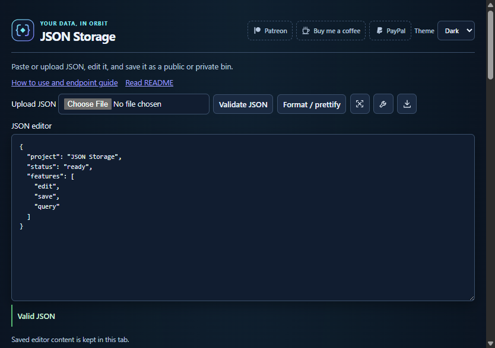
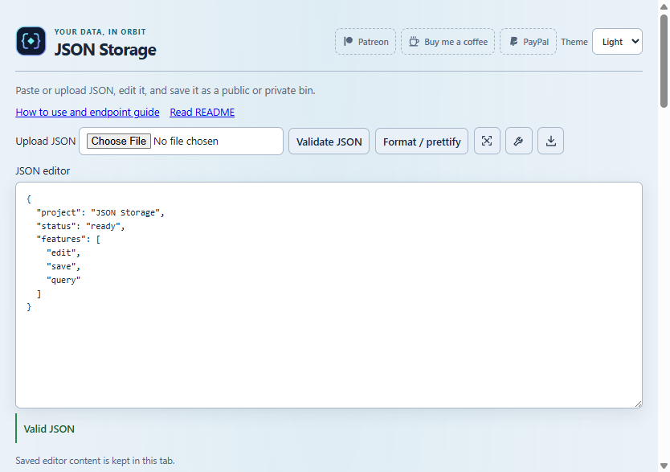
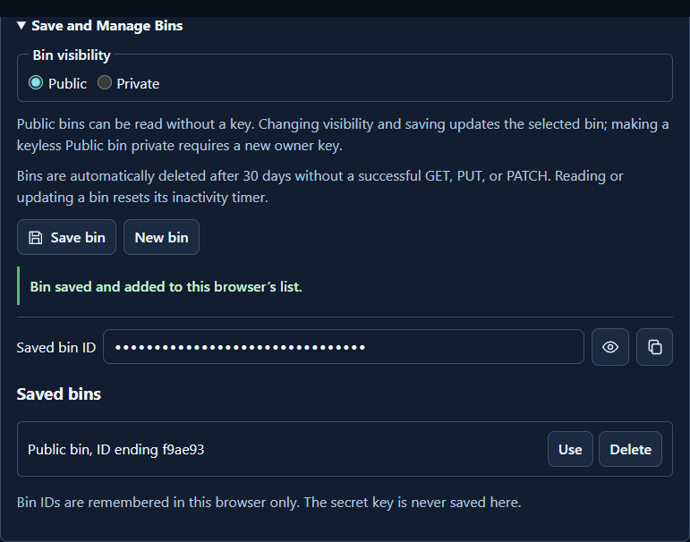
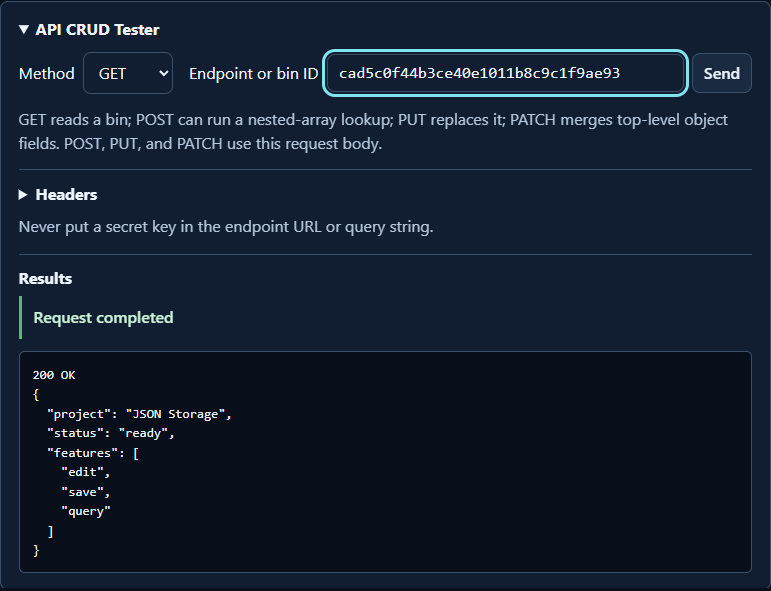
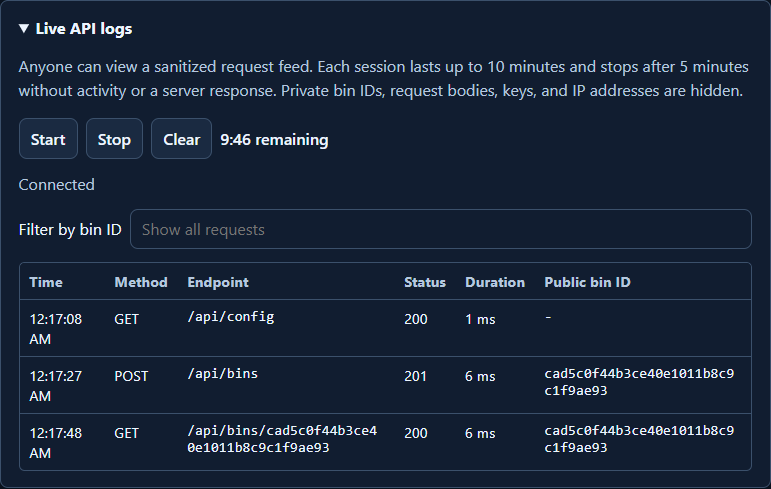

# Node.JSONStorage

A self-hosted JSON bin service built with Node.js. The server exposes an HTTP API, serves the browser client, and persists each bin as an individual JSON file.

DEMO [https://jsonstorage.ohmcodes.com/](https://jsonstorage.ohmcodes.com/)

## Features and Screenshots

- **JSON editor:** Upload, validate, format, compact, repair, and download JSON. Drafts are kept in the current tab.
- **Bin storage:** Save public or private bins and manage saved bins from the browser.
- **API tools:** Send requests with the CRUD tester and view sanitized live API logs.
- **Appearance:** Choose between dark and light themes.

See the [feature index](FEATURES.md) for the full list and service limits.

### JSON editor and themes

Dark theme (default):



Light theme:



### Save and manage bins



### API CRUD tester



### Live API logs



## Requirements

- Node.js 18 or newer
- npm

## Install and Run

From the repository directory:

```sh
npm install
cp .env.sample .env
npm start
```

Open http://127.0.0.1:3000. The default listener is `127.0.0.1:3000`, and data is stored in `./data`.

Edit `.env` to configure the local server. On PowerShell, copy the sample with `Copy-Item .env.sample .env`.

PowerShell environment overrides:

```powershell
$env:PORT = '3001'
$env:HOST = '127.0.0.1'
$env:DATA_DIR = 'C:\json-storage-data'
npm start
```

`PORT`, `HOST`, and `DATA_DIR` can also be set in the process environment before running `npm start`; process environment variables override `.env`. To remove an old PowerShell override and use `.env`, run `Remove-Item Env:DATA_DIR -ErrorAction SilentlyContinue` in that terminal before starting the server. Use one server process per data directory. For deployment, use persistent storage and HTTPS; never send secret keys over unencrypted connections.

The server loads `.env` at startup. `DATA_DIR=./data` stores account data in `data/accounts.json` and each bin in `data/bins/<bin-id>.json` when started from the repository directory. Donation destinations are configured with `PATREON_URL`, `BUY_ME_A_COFFEE_URL`, and `PAYPAL_DONATE_URL`; placeholder URLs remain disabled. Process environment values take precedence over `.env`.

The browser interface defaults to a dark theme. Use the Theme selector to choose light or dark; the selection is remembered in browser storage when available. Donation links appear in both the header and footer and are enabled by the same settings.

## Docker

Copy `.env.sample` to `.env`, then run:

```sh
docker compose up -d --build
```

Compose publishes port `3012` and sets the container to bind `0.0.0.0:3012`, independent of the local `.env` port. It bind-mounts the host directory configured by `DATA_DIR` (default `./data`) into `/usr/src/app/data` in the container. Bin and account files therefore remain in the host data directory when the container is recreated. Back up that directory separately.

## Project Layout

- `server.js` contains the HTTP server, API routes, authorization, file persistence, cleanup, and live-log stream.
- `public/app.js` is the ES-module entry point; `events.js` binds listeners, `actions.js` contains user actions, `api.js` handles HTTP requests, `bins.js` manages saved bins, and `live-logs.js` owns the event stream.
- `public/core.js`, `draft.js`, `theme.js`, and `bin-sync.js` provide shared state and focused browser helpers. `donations.js` activates links configured in `.env`.
- `public/index.html` and `style.css` contain the page structure and presentation.
- `test/` contains API and browser-script regression tests using Node's built-in test runner.
- `data/` is the default runtime storage directory and is excluded from version control.

## HTTP API

All endpoints are relative to the server root. JSON request bodies require `Content-Type: application/json`. Owner keys are sent with the `X-Secret-Key` header and must never be placed in a URL or query string.

For `curl`, add the header explicitly:

```sh
curl -H 'X-Secret-Key: YOUR_KEY' http://127.0.0.1:3000/api/bins/BIN_ID
```

For JavaScript `fetch`, include it in `headers`:

```js
fetch('/api/bins/BIN_ID', {
  headers: { 'X-Secret-Key': 'YOUR_KEY' }
});
```

Method-specific `curl` examples:

```sh
# Public GET: no key header is needed.
curl http://127.0.0.1:3000/api/bins/BIN_ID

# Private GET: include the owner key.
curl -H 'X-Secret-Key: YOUR_KEY' http://127.0.0.1:3000/api/bins/BIN_ID

# PUT: the header and JSON content type are required.
curl -X PUT -H 'X-Secret-Key: YOUR_KEY' -H 'Content-Type: application/json' \
  --data '{"hello":"replacement"}' http://127.0.0.1:3000/api/bins/BIN_ID

# PATCH: the header and a JSON object body are required.
curl -X PATCH -H 'X-Secret-Key: YOUR_KEY' -H 'Content-Type: application/json' \
  --data '{"extra":true}' http://127.0.0.1:3000/api/bins/BIN_ID
```

Never include the key in the URL or query string. A public `GET` request does not need this header; private reads and all create, update, and delete requests do.

| Method | Path | Behavior |
| --- | --- | --- |
| POST | `/api/accounts` | Create an account and return its owner key once. |
| POST | `/api/bins?visibility=public` | Create a public bin. An owner key is optional; without one the server issues a same-browser management cookie. |
| POST | `/api/bins?visibility=private` | Create a private bin from the request body. |
| POST | `/api/bins/:id/query` | Filter nested arrays and select matching values. Public bins can be queried without a key; private bins require the owner key. |
| HEAD | `/api/bins/:id` | Check whether a bin exists and read its visibility header without reading the JSON or extending expiry. |
| GET | `/api/bins/:id` | Read a bin. Public reads need only the ID; private reads need the owner key. |
| PUT | `/api/bins/:id?visibility=public\|private` | Replace the bin's JSON value and optionally change visibility. Making a keyless Public bin private requires its owner cookie and a valid destination owner key; ownership and quota move to that account. |
| PATCH | `/api/bins/:id` | Shallow-merge an object into the bin's JSON value. Owner key or creating-browser cookie required for keyless Public bins. |
| DELETE | `/api/bins/:id` | Delete the bin. Owner key or creating-browser cookie required for keyless Public bins. |
| POST | `/api/repair` | Repair malformed JSON text and return formatted JSON. |
| GET | `/api/live-logs` | Public Server-Sent Events stream for the live log panel. |

Private reads and cross-client writes/deletes require the owning key in `X-Secret-Key`. Keyless Public bins use a random HttpOnly, `SameSite=Strict` cookie on the creating browser for updates/deletes. A visibility change on `PUT` requires authorization for the current bin; making it Private also requires a valid destination owner key. The bin ID alone never authorizes a change or deletion. Never put a key in a URL.

Example using curl (replace `YOUR_KEY` and `BIN_ID`):

```sh
curl -X POST http://127.0.0.1:3000/api/accounts
curl -X POST 'http://127.0.0.1:3000/api/bins?visibility=private' \
  -H 'X-Secret-Key: YOUR_KEY' -H 'Content-Type: application/json' \
  --data '{"hello":"world"}'
curl -X POST http://127.0.0.1:3000/api/bins/BIN_ID/query \
  -H 'Content-Type: application/json' \
  --data '{"steps":[{"array":"DinoRewards.Dinos","where":{"Blueprint":{"contains":"Dodo"}}},{"array":"Award","level":25,"select":"Points"}]}'
curl -H 'X-Secret-Key: YOUR_KEY' http://127.0.0.1:3000/api/bins/BIN_ID
curl -X DELETE -H 'X-Secret-Key: YOUR_KEY' http://127.0.0.1:3000/api/bins/BIN_ID
```

Lookup filters support exact scalar values and `eq`, `ne`, `lt`, `lte`, `gt`, `gte`, `in`, and case-sensitive string `contains` operators. A lookup step can use `level` to match award objects whose numeric `MinLevel` and `MaxLevel` bounds contain that value, without specifying the bounds in the request. Use the complete Blueprint string for an exact match; use `{ "contains": "Dodo" }` to match a partial Blueprint name. A single selected result returns an object such as `{"Points":5}`; multiple matches return an array of objects, and no matches return `[]`.

## Live Request Logging

`GET /api/live-logs` streams sanitized events using Server-Sent Events. The server keeps at most 200 recent events in memory, allows up to 20 concurrent subscribers, and ends sessions after 10 minutes or 5 minutes without activity. Private bin IDs and paths are redacted. Request bodies, secret keys, account identifiers, and IP addresses are not recorded; events are not written to disk.

## Bin Expiration

Each bin is automatically deleted after 30 days without a successful `GET`, `PUT`, or `PATCH`. Any of those successful requests updates its last-access time; public reads count as use. The cleanup sweep runs hourly and at server startup, so a bin may remain for up to about one hour beyond the 30-day threshold while the server is running. Expiration removes the individual bin file and releases its bytes from the owner's quota. A stale browser saved-bin entry is removed when Use or Delete next discovers the bin has expired.

## Limits and Storage

- Maximum request body: 1 MiB
- Maximum individual bin: 100 KiB of compact UTF-8 JSON
- Maximum account storage: 10 MiB
- Maximum successful bin API requests: 10,000 per account per UTC month
- Bin inactivity expiration: 30 days since the last successful GET, PUT, or PATCH

The server stores account metadata in `DATA_DIR/accounts.json` and each bin in its own file under `DATA_DIR/bins/<bin-id>.json`. A bin file contains its owner-key hash, visibility, JSON value, and size; the account index contains quota and request counters but never plaintext keys. Keyed account records are retained after their last bin is deleted so the key and monthly counters remain valid. Cookie-only account records are removed when their last bin is deleted or transferred, and startup removes marked cookie-only records left with no bins after manual file removal. Prefer the app's Delete action because it also updates the owner's quota; manual file removal should be done while the server is stopped. The browser checks saved IDs against the server on page load/focus and removes entries for missing bins.

On startup, an existing `DATA_DIR/storage.json` is migrated into `accounts.json` and per-bin files, then renamed to `storage.json.migrated` (or a numbered variant if that archive name already exists). Public reads by other users count toward the bin owner's monthly request allowance. Failed validation and unauthorized requests do not count.

Run only one process per `DATA_DIR`; the file store does not coordinate concurrent processes or hosts. Back up the data directory separately. The service does not provide account recovery or account deletion. Treat private bin IDs as sensitive even though they are not credentials by themselves.

## Tests

Run the API and browser-script regression tests with:

```sh
npm test
```
